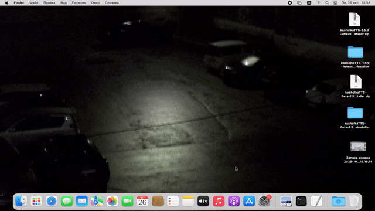

# kasholkaTTS

[](https://github.com/muratbstr/kasholkaTTS/releases)

Локальная, бесплатная open-source читалка текста для **macOS Monterey 12 и новее**, на Intel и Apple Silicon.
Использует системные голоса, интерфейс на русском и английском.

**Счётчик учитывает скачивания архивов для ручной установки `*-macOS-manual-installer.zip`.**

- **Основная версия — 1.7.8 Release 3:** зелёная иконка.
- **[kasholkaTTS Beta — 1.8.4 Beta 2](beta/README.md):** синяя иконка, дополнительные
  эксперименты с Siri. Устанавливается рядом и хранит настройки отдельно.

История изменений: [CHANGELOG.md](CHANGELOG.md).

Скачать: **[1.7.8 Release 3](https://github.com/muratbstr/kasholkaTTS/releases/tag/v1.7.8)**
или **[1.8.4 Beta 2](https://github.com/muratbstr/kasholkaTTS/releases/download/v1.8.4-beta.2/kasholkaTTS-Beta-1.8.4-Beta-2-macOS-manual-installer.zip)**.

## Установка и обновление

1. Скачайте на Mac `kasholkaTTS-1.7.8-Release-3-macOS-manual-installer.zip` со страницы релиза.
2. Распакуйте ZIP целиком и откройте `Install kasholkaTTS.command`.
3. Выберите **Русский** или **English**, дождитесь завершения установки и нажмите **«Открыть»**.

Установщик сначала предлагает **Русский / English** и **Отмена / Cancel**, затем показывает
только этапы на выбранном языке. Отмена закрывает установщик до изменения файлов. При необходимости:
`/bin/bash "Install kasholkaTTS.command" --lang ru` или `--lang eng`.
При ошибке появится путь к журналу с подробностями.
Автообновление пропускает выбор языка и использует настройку приложения или macOS.

Приложение устанавливается в `~/Applications/kasholkaTTS.app` (ярлык приложения в Launchpad). В дальнейшем
запускайте его, а не установщик. Перед обновлением завершите приложение через **⌘Q**
и распакуйте новый архив в отдельную папку. Предыдущая версия сохраняется рядом
в папке `kasholkaTTS-backup.*`.

Это ZIP с установщиком `.command`: приложение собирается встроенными средствами Mac.
Для установки не нужны интернет, пароль администратора, Xcode или сторонние программы.
**На Windows установщик не запускается.**

У приложения локальная подпись, без нотарификации Apple. Если Monterey блокирует
знакомый вам установщик, используйте **правую кнопку → Открыть**; при необходимости
разрешите этот файл в **Системные настройки → Защита и безопасность → Основные**.
Если архиватор потерял право запуска: наберите в Терминале `/bin/bash `,
перетащите туда файл установщика и нажмите Enter.

Для удаления завершите приложение и перенесите его в Корзину.

## Установка голосов



Голос Siri выбран для примера, **работа голосов Siri не гарантированы в программе**!

В конце ждём, пока установится голос.

## Обновления из GitHub

В меню **kasholkaTTS → Обновления** можно проверить новую версию, отключить проверку
при запуске или отменить загрузку. Автопроверка включена по умолчанию и выполняется
при каждом запуске после закрытия экрана загрузки, без ожидания суток. Ход проверки
и отсутствие новой версии показываются в строке состояния без лишних окон.
Проверка вручную доступна всегда, в том числе при отключённой автопроверке.

Программа предложит скачать выпуск, проверит SHA-256 и затем предложит **«Установить
и перезапустить»**. Дальше установка проходит автоматически, без Терминала и пароля
администратора. Во время чтения, экспорта и поиска голосов предложение подождёт.
Нужен запуск из `~/Applications/kasholkaTTS.app` (для Beta — `kasholkaTTS Beta.app`).

Текст и выделение временно сохраняются только на Mac и восстанавливаются после
перезапуска; эта копия удаляется после восстановления. Прежняя сборка сохраняется
в `~/Applications/kasholkaTTS-backup.*` (у Beta отдельная папка). При сбое установки
приложение пытается открыть прежнюю сборку, журнал сохраняется для диагностики.

Обычная версия получает только обычные релизы, Beta — только Beta. Черновики,
незавершённые загрузки, сборки без контрольной суммы и более старые версии исключены.
Загрузка идёт из [релизов проекта](https://github.com/muratbstr/kasholkaTTS/releases),
без аккаунта GitHub. Текст и сведения о голосах по сети не отправляются.
SHA-256 проверяет целостность скачанного файла, но не заменяет подпись разработчика.

**Если приложение не запускается, установите Release 3 вручную.**
В работающем приложении можно проверить обновление через меню «Обновления».
Переход с 1.5.x также ручной: там ещё нет обновлятора.
Если более нового выпуска нет, проверка сообщит, что обновлений нет. [Устройство и проверки обновлятора](docs/UPDATES.md).

## Основные функции

- **Вид → Тема:** как в macOS, светлая или тёмная. Применяется сразу и сохраняется;
  смена темы не прерывает чтение. Основная версия и Beta хранят выбор отдельно.

- **kasholkaTTS → Язык / Language:** Русский, English или как в macOS. Выбор применяется
  при следующем запуске; текущие текст и чтение не прерываются. У Beta язык сохраняется отдельно.
  [Как добавить перевод](docs/LOCALIZATION.md).
- Вставка текста через **⌘V**, открытие `.txt` и `.md` через **⌘O**.
- Голоса сгруппированы по языкам и регионам. **«Прослушать»** произносит короткую
  пробу выбранного голоса, сохраняя текст и выделение.
- **«Читать»** озвучивает выделение или весь текст, если выделения нет.
  **«Пауза» / «Продолжить»** управляют чтением, **«Стоп»** завершает его.
- Ползунок скорости: слева медленнее, справа быстрее, середина — естественный темп.
  Изменения применяются при новом чтении. Голос и скорость меняются после остановки.
- Подсветка текущего слова и **Вид → Автопрокрутка при чтении**.
- Масштаб интерфейса через меню **Вид**: **⌘=**, **⌘−**, **⌘0**. Диапазон 80–150%,
  верхний предел зависит от размера экрана.
- **Дебаг → Высота голоса…** — экспериментальная настройка для выбранного голоса.
  Поддержка зависит от голоса; значение хранится только до выхода.
- Голос, скорость и масштаб запоминаются. Истории текстов нет.
  Закрытие главного окна или **⌘Q** завершает программу и чтение.

Для проверки есть [длинный тестовый TXT](samples/kasholkaTTS-long-test.txt).
Дополнительные голоса устанавливаются средствами macOS:
**Универсальный доступ → Устный контент → Голос системы → Настроить**.
После загрузки нажмите **«Обновить»** в читалке.

## Сохранение речи

**Файл → Сохранить речь в аудиофайл… (⌘S)** сохраняет весь текст или выделение
выбранным голосом с текущими параметрами. Выберите формат и качество, затем имя и папку:

| Формат | Варианты |
| --- | --- |
| M4A | AAC, 64 / 128 / 192 кбит/с, 44,1 кГц |
| WAV | PCM, 16 / 24 бит, частота исходного голоса |
| Исходное аудио | AIFF для классического движка, CAF для AVFoundation |

**Для экспорта голосов AVFoundation и помощников нужны уже установленные
Apple Command Line Tools или Xcode.** Программа сама их не устанавливает.
Для классических голосов дополнительные инструменты не нужны.

Экспорт идёт без звука из динамиков. **«Стоп»** отменяет синтез или преобразование;
пауза недоступна. Существующий файл заменяется только после успешного завершения.
Более высокое качество файла не добавляет деталей исходному голосу.

## Ограничения и диагностика

- **Siri не гарантированы**, даже если скачаны в настройках macOS. Ручной поиск:
  **Дебаг → Поиск голосов Siri**. Проверяются osascript и, при необходимости, Swift;
  для Swift нужны инструменты Apple. На Monterey **12.6.5** в отчёте пользователя
  все три способа получили **77 голосов и 0 Siri**. Дополнительные варианты описаны
  в [инструкции Beta](beta/README.md).
- У **Юрия** известно смещение подсветки: классический движок возвращает неверные
  диапазоны. Проблема не устранена полностью.
- **Дебаг → Диагностика голосов…** копирует сведения о системе и голосах без текста
  редактора. **Диагностика подсветки…** включается вручную на одно чтение и содержит
  короткие фрагменты текста. Её отчёт хранится в памяти до выхода.
- Звук, интерфейс и установка требуют проверки на настоящем Mac. Тесты на Windows
  этого не подтверждают. [Чек-лист для Mac](tests/MAC_SMOKE_TEST.md).

Помощники используют временные файлы с доступом только текущему пользователю;
обычное завершение удаляет их. После аварийного выхода могут остаться временные
папки, в том числе `.kasholkaTTS-…` рядом с экспортируемым файлом.

## Сборка из исходников

На Windows нужен **Python 3.9+**, без сторонних библиотек. Команды из папки проекта:

```powershell
python scripts/build_release.py
python scripts/build_beta.py
python -m unittest discover -s tests -v
```

Каждая из первых двух команд создаёт два ZIP с отдельными SHA-256 в `dist/`:
`*-macOS-manual-installer.zip` для ручной установки и `*-macOS-installer.zip` для автообновления.
В релиз нужно прикреплять все четыре файла своего канала; ссылка для пользователей ведёт на ручной ZIP.
[Правила публикации и счётчика](docs/UPDATES.md#раздельные-архивы-и-счётчик). Сборка пишет файлы внутри проекта и не меняет настройки Windows.
Mac-проверки на Windows пропускаются.

- [src/kasholkaTTS.js](src/kasholkaTTS.js) — основной код приложения.
- [VERSION](VERSION) и [beta/VERSION](beta/VERSION) — версии двух выпусков.
- [beta/README.md](beta/README.md) — устройство Beta, эксперименты и источники исследования Siri.
- [assets/README.md](assets/README.md) — происхождение и сборка иконки, видео и фона.

**ДО ПЕРВОГО ПУБЛИЧНОГО РЕЛИЗА:**
- [changelog_before_rel.md](changelog_before_rel.md) — описание изменений старых версий
- [beforerel](beforerel) — старые версии

## Авторы
- **Код, помощь с дизайном:**  GPT-6 Astra (VS Code + Codex)
- **Идея, промпт, дизайн:** strch

## Лицензия/License
- **MIT**

  Делайте что хотите на основе этого проекта, но не безобразничайте :)

  Do whatever you like with this project, but don’t go over the top :)
